# Phone PC Hypnotiser

<p align="center">
  
</p>

<p align="center">
  <a href="https://github.com/theharshk/phone-pc-hypnotiser/actions/workflows/ci.yml">
    
  </a>
</p>

> 🚧 **Project Status: Work in Progress (WIP)**  
> This project is currently in active development. Core remote control features (Touchpad, Keyboard, Media, Power, and Screen Streaming) are fully functional over local Wi-Fi with an automated headless test suite. Conversion into a standalone `.exe`, installer generation, and extended features are underway.

A self-hosted, lightweight remote control system allowing an Android smartphone to control a Windows PC over local Wi-Fi. Built with a **Java (Spring Boot)** host and a zero-install **Progressive Web App (PWA)** client.

---

## 📸 Screenshots & Interface

### 🖥️ Desktop Host & Admin Dashboard (Loopback-Only)
*Secure loopback-only control panel (`http://localhost:8080/admin`) for connection QR codes, PIN management, active session monitoring, and device approvals.*

| Connection Overview & QR Code | Paired Devices & Approval Queue |
| :---: | :---: |
| 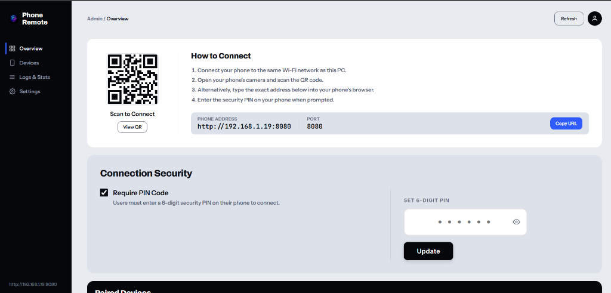 | 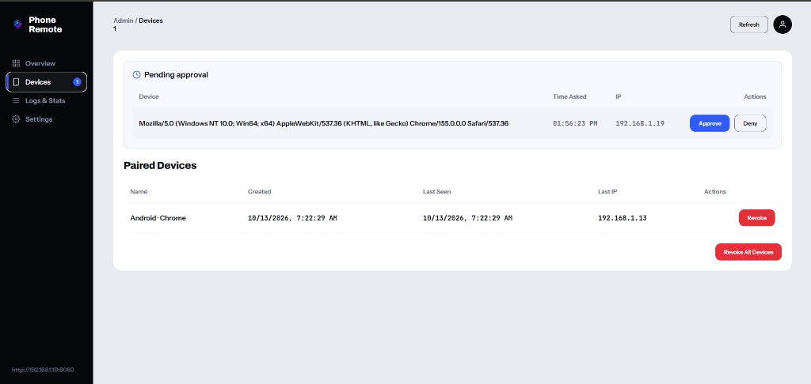 |

---

### 📱 Mobile Client Navigation & Settings
*Zero-install progressive web application with instant connection metrics, ultra-low latency status (< 5 ms), and customizable haptic feedback.*

| Dark Mode (OLED) | Light Mode | Settings & Presets |
| :---: | :---: | :---: |
| 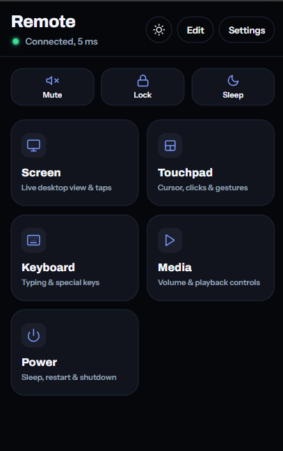 | 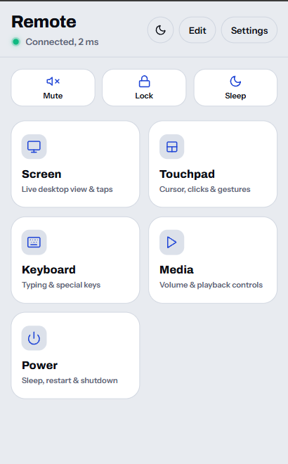 | 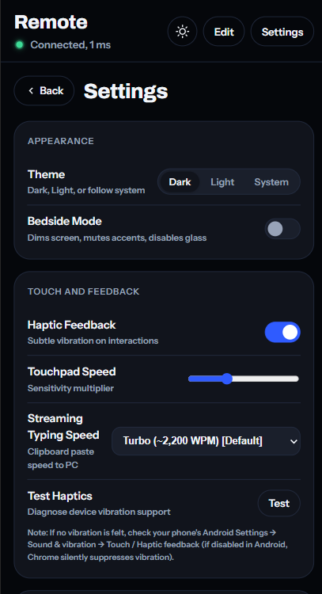 |

---

### 🎮 Mobile Remote Control Modules
*Responsive touch-optimized control modules engineered for real-time interaction over local Wi-Fi.*

| Touchpad | Keyboard & Modifiers | Media Controls | Screen Streaming | Power Actions |
| :---: | :---: | :---: | :---: | :---: |
| 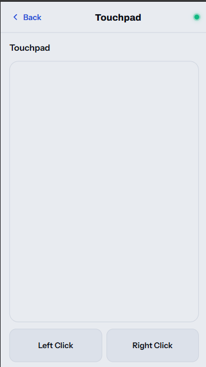 | 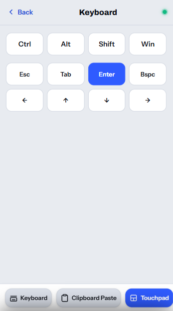 | 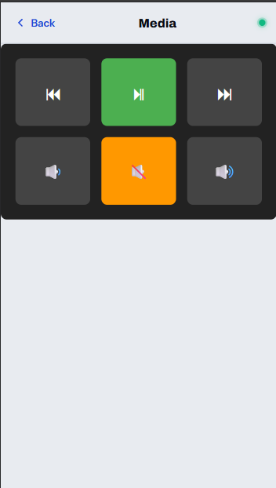 | 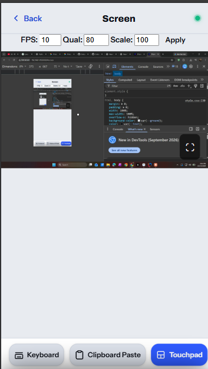 | 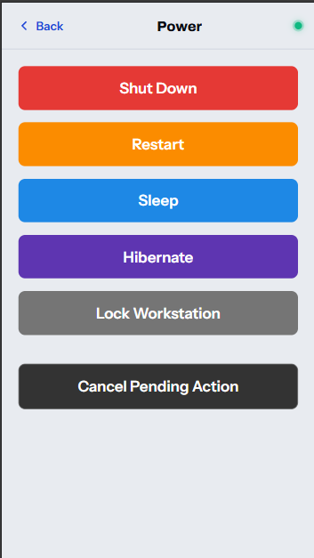 |

---

## Features

- **Touchpad:** Smooth cursor control, tap-to-click, two-finger right click, two-finger scroll, and tap-and-drag.
- **Keyboard & Clipboard Modes:**
  - *Live Inline Typing:* Live keystroke typing via mobile soft keyboard (Gboard, Samsung Keyboard, etc.) with modifier combos (Ctrl, Alt, Shift, Win), Esc, Tab, Enter, Backspace, and arrow keys.
  - *Direct Clipboard Paste:* Long clipboard snippets pasted into the input stream in fast 50-character native Unicode chunks.
  - *Streaming Typing Engine:* Dedicated "Clipboard Paste" modal types character-by-character (~2,200 WPM) via native Unicode keystrokes to bypass website paste restrictions. Consecutive newlines (`\n\n`) each emit distinct virtual Enters with key-hold timing, tabs (`\t`) preserve indentation, and a live "Typing to PC..." UI provides real-time progress with an instant "Stop" button.
- **Media Controls:** Play/Pause, Next Track, Previous Track, Volume Up/Down, and Mute using Windows multimedia keys.
- **Power Actions:** Shutdown, Restart, Sleep, Hibernate, and Lock Workstation with hold-to-confirm safeguards and cancellation timer.
- **Live Screen Streaming:** Real-time JPEG screen capture with adjustable quality, scaling, and tap-to-control coordinate mapping.
- **Admin Dashboard:** Loopback-only desktop panel (`http://localhost:8080/admin`) for device management, live session tracking, real-time FPS/latency metrics, security PIN updates, and log inspection.
- **System Tray Icon:** Quick status view, browser shortcut to Admin Dashboard, one-click "Disable remote control now" kill-switch, auto-start toggle, and clean shutdown.
- **Auto-Start:** Seamless Windows Task Scheduler integration (`schtasks`) to start the server at user logon in the background.

---

## Architecture

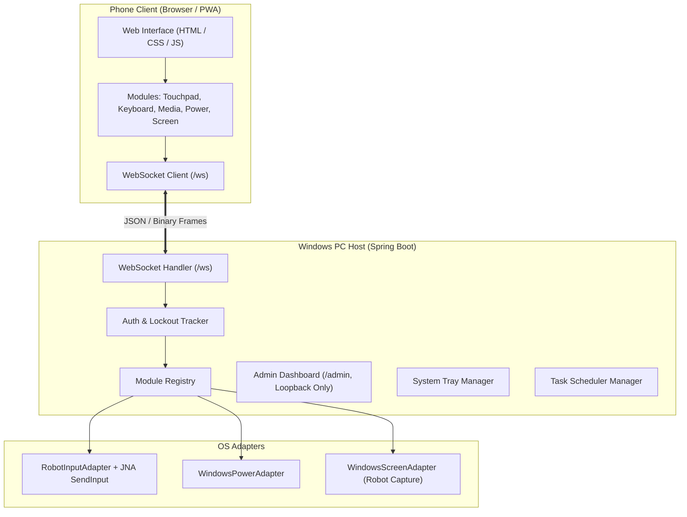

---

## 🗺️ Project Roadmap & Future Plans

### ✅ Completed & Tested (Current Version)
- [x] **Core Remote Control:** Smooth cursor deltas, Unicode keyboard injection, multimedia controls, and safe power actions.
- [x] **Low-Latency Screen Streaming:** Pipelined capture-encode-send threads (~10 fps at 720p).
- [x] **Security & Auth:** Salted BCrypt PIN pairing, live session revocation, rate-limited lockout, and loopback-only admin dashboard.
- [x] **Automated Testing & CI:** 107 total automated tests (66 Java backend JUnit tests + 41 Node.js frontend tests) running headless with 100% pass rate.

### 🚀 Next Up: Standalone Executable & UX
- [ ] **Native `.exe` Conversion (`jpackage`):** Package the Java application into a standalone Windows `.exe` with an embedded, stripped-down Java runtime (via `jlink`). End users will **not need Java or Maven installed** on their PC.
- [ ] **Windows Installer:** Provide a single-click `.exe` / `.msi` setup wizard that installs the app, adds Start Menu shortcuts, and bundles desktop icons.
- [ ] **Windows Registry Auto-Start:** Migrate auto-start from Task Scheduler to `HKCU\Software\Microsoft\Windows\CurrentVersion\Run` so auto-start can be toggled without requiring Administrator rights and integrates directly with Windows Task Manager.
- [ ] **Branded App Icon Integration:** Apply the custom power/hypnotic icon to the Windows System Tray, Taskbar, and browser PWA/Favicon.

### 🔮 Future Milestones (v2 & Beyond)
- [ ] **High-Performance Screen Capture:** Replace `Robot.createScreenCapture` with native GDI `BitBlt` or Desktop Duplication API (DirectX) for 30+ FPS streaming, with optional H.264 video encoding.
- [ ] **Internet / WAN Remote Access (v2):** Secure remote access outside local Wi-Fi via Tailscale HTTPS or an end-to-end encrypted relay tunnel.
- [ ] **Virtual Gamepad Module (v3):** Virtual Xbox 360 controller emulation via ViGEmBus driver, featuring dual touch joysticks, triggers, and phone gyroscope motion steering.

---

## Setup and Installation

### Prerequisites
- Windows 10 or 11
- Java 17 or higher (Java 21 recommended)
- Maven 3.8+

### 1. Build
Clone the repository and build the server module:
```powershell
cd server
mvn clean package
```
*(Or from the repository root: `mvn clean package -f server/pom.xml`)*

### 2. First Run (Terminal Wizard)
Run the application from a terminal once to set up your security PIN:
```powershell
java -jar target/server-1.0-SNAPSHOT.jar
```
*(Or from the repository root: `java -jar server/target/server-1.0-SNAPSHOT.jar`)*

The interactive wizard will prompt:
```text
=== Phone PC Hypnotiser First Run ===
Set a 6-digit PIN? (recommended) [y/n]: y
Enter 6-digit PIN: 123456
PIN set securely. You will need it to pair your first device.
==============================
```
*(If skipped, the system operates in manual approval mode where each connecting phone must be approved on the PC Admin page).*

On startup, the console outputs:
```text
Phone address: http://<LAN-IP>:8080
Admin address: http://localhost:8080/admin
```

### 3. Pairing Your Phone
1. Open the **Phone address** on your phone's browser while connected to the same Wi-Fi network.
2. Enter your 6-digit PIN.
3. Once authenticated, a revocable 32-byte cryptographic token is saved in `localStorage`, and the remote control tiles appear immediately.

### 4. Background Start & Auto-Start Setup Guide

Windows Task Scheduler requires administrator privileges to register a task that executes automatically at user logon (`/SC ONLOGON`). Follow this quick one-time guide to enable auto-start:

1. **Open PowerShell as Administrator:**
   - Press the Windows Key, type `PowerShell`, right-click **Windows PowerShell**, and select **"Run as Administrator"**.
2. **Launch the Server from the Admin Terminal:**
   ```powershell
   cd "path\to\phone pc hypnotiser\server"
   java -jar target\server-1.0-SNAPSHOT.jar
   ```
3. **Enable Auto-Start from the System Tray:**
   - Locate the **Phone PC Hypnotiser** icon in your Windows System Tray (next to the clock in the taskbar).
   - Right-click the icon and click **"Enable auto-start"**.
   - With administrator privileges active, Windows Task Scheduler successfully creates the `PhonePCHypnotiser` scheduled task.
4. **Done!**
   - You can now close the terminal or quit the app.
   - On every future Windows login, Phone PC Hypnotiser will launch silently in the background.

*(Note: Migration to standard unprivileged `HKCU` Windows Registry auto-start is planned on the roadmap to remove this one-time admin requirement).*

> **Background Launch Note:** When launched automatically in the background (no interactive terminal), the server checks for an existing `config.json`. If unconfigured, it exits immediately with:
> `Run once from a terminal to set a PIN`

---

## Windows Firewall

On first run, Windows asks to allow the app. Choose **Private networks only**.

If the phone can’t connect:
- Check that your Wi-Fi network profile is set to **Private** in Windows settings.
- Ensure the app / Java is not blocked under **Windows Security** → **Firewall & network protection** → **Allow an app through firewall** (Private checked).

---

## Pairing and Revocation

```
Phone                         Server                       PC / Admin
  |-- hello ------------------->|
  |                             | Token valid? Yes -> ready
  |<-- need_pin ----------------| (Token missing / PIN required)
  |-- pin ---------------------->| Verify BCrypt hash & rate limits
  |<-- paired (token) ----------| Store SHA-256 token hash
  |                             |
  |  (If No PIN configured)     |-- Pending Approval ---------->|
  |<-- pending_approval --------|<----------- Approve / Deny ---|
  |<-- paired (token) ----------|
```

### Instant Live Revocation
- When a device is revoked or deleted from the desktop Admin Dashboard (`/admin`), the server:
  1. Finds the device's active WebSocket sessions via a thread-safe index.
  2. Dispatches an immediate `{"m":"core","t":"error","d":{"code":"revoked"}}` packet.
  3. Calls `onClose()` on all active modules: **releasing every held key and mouse button and stopping capture threads**.
  4. Marks the session unauthenticated and closes the socket.
  5. The mobile client clears stored credentials, halts outgoing messages, and displays a "Device Revoked" banner.
- **Heartbeat Safety Net:** During periodic WebSocket `ping`/`pong` cycles (every 10 seconds), the server re-validates that the device record exists in configuration.

---

## Security Notes

- **Credential Safety:** PINs are hashed using salted BCrypt. Plaintext PINs and tokens are never logged or stored.
- **Brute Force Protection:** Escalating rate limiting locks out attackers after 5 invalid attempts (5 minutes initial, doubling up to 24 hours). A PIN sent during an active lockout is not counted and does not extend the timer.
- **Admin Surface Isolation:**
  - The `/admin` endpoints bind strictly to loopback (`127.0.0.1` / `[::1]`). Non-loopback requests are rejected with `403 Forbidden`.
  - Enforces `Host` header validation against DNS rebinding.
  - Requires CSRF tokens on state-modifying requests and validates WebSocket `Origin` headers.
- **Safe Execution:** Power actions and commands are restricted to strict enum whitelists with short-lived (10s) confirm tokens. No client-supplied input is ever passed to an operating system shell.
- **Logging Auditing:** App and frame logs automatically rotate (10 MB per file, max 3 retained). No typed keystrokes, passwords, tokens, raw payloads, or screen buffers are logged.

---

## Screen Streaming Performance

- **Staged Pipeline:** Decoupled threads joined by bounded `ArrayBlockingQueue`s (capacity 2):
  `Capture Thread` $\rightarrow$ `Scale Thread` $\rightarrow$ `Encode Thread (JPEG)` $\rightarrow$ `Send Thread`.
- **Backpressure Management:** At most 2 unacknowledged frames remain in flight. If the client is slow or network lags, captures are skipped rather than queued, keeping latency flat.
- **Measured Latency & Throughput (Windows Laptop):**
  - **Before Pipelining:** ~5 fps (sequential capture and encode blocking the loop).
  - **After Pipelining:** ~10 fps at ~720p (Capture: ~70–110 ms, Scale: ~5–12 ms, Encode: ~40–98 ms, Frame size: 50–105 KB).
  - **Bottleneck:** `java.awt.Robot.createScreenCapture` is the primary throughput bottleneck.

---

## Design Decisions

1. **Why WebSocket:** A single full-duplex WebSocket connection at `/ws` carries both JSON control messages and binary JPEG screen frames. This avoids the HTTP request/response handshake overhead, lowers LAN input latency to under 50 ms, gives continuous connection state for heartbeat tracking, and centralizes authentication to a single check.
2. **Why Adapters:** Operating system operations (`Robot`, JNA `SendInput`, process invocation, screen capture) are abstracted behind adapter interfaces (`InputAdapter`, `PowerAdapter`, `ScreenAdapter`). This completely decouples domain modules from native Windows APIs and allows the entire test suite to execute on headless CI environments using fake/mock adapters without requiring physical screens or displays.
3. **Backpressure Strategy:** High-frequency screen streaming decoupled across capture, encode, and send threads uses bounded queues (capacity 2) and drops oldest frames when downstream consumers fall behind. The server enforces a maximum of 2 unacknowledged frames in flight. This guarantees that latency never spikes or accumulates buffer lag under Wi-Fi fluctuations.
4. **Live Revocation:** Authentication state is treated as a live, continuous session property rather than only a one-time check during `hello`. When an administrator revokes a device, an in-memory device-to-sessions index instantly terminates active sockets, fires module cleanup (`onClose` releases held mouse buttons and keys), and clears credentials on the client.
5. **Lockout Design:** PIN brute-force attempts are throttled by escalating lockouts (5 wrong tries trigger 5 minutes, doubling on repeat attempts). Crucially, PIN attempts submitted during an active lockout are ignored—they are neither counted as new failures nor do they extend the remaining lockout window—preventing malicious permanent denial of service.
6. **Why Plain HTTP for Now:** Local Wi-Fi setup requires zero friction for ordinary users. Self-signed TLS certificates require installing and trusting custom root CA certificates on mobile devices, which creates significant onboarding hurdles. Plain HTTP works out-of-the-box in under 2 minutes. Secure HTTPS and WAN remote access are architected for v2 (via Tailscale or relay tunnels), which will also unlock full PWA service workers and offline caching.

---

## Testing

The project is backed by **107 automated tests** (66 Java backend + 41 Node.js frontend) running completely headless without requiring a display or physical screen:

```powershell
# Run backend Java test suite (66 tests)
cd server
mvn test

# Run frontend Web test suite (41 tests)
cd ../web
node --test client.test.mjs
```

### 1. Backend Java Test Suite (66 tests — JUnit 5, Mockito, Spring Boot Test)
Run via `mvn test` in `server/` (and automated on GitHub Actions CI):
- **Unit & Logic Tests (18 tests):** PIN hashing (BCrypt), lockout tracker escalation and freezing with mock clocks, cryptographic token hashing and verification, atomic file configuration writes, and layout persistence.
- **Module & Adapter Tests (28 tests):** Touchpad coordinate delta handling, keyboard Unicode and sticky modifier states, media keys, power confirm tokens and delayed shutdown scheduling, and screen frame pipeline formatting against `FakeInputAdapter`, `FakePowerAdapter`, and `FakeScreenAdapter`.
- **System Tray & Auto-Start Tests (10 tests):** Task Scheduler task generation, logon command building, tray menu lifecycle, and background config verification.
- **Security & Hardening Tests (10 tests — `SecurityTests`):**
  - Rejection of unauthenticated messages across touchpad, keyboard, media, power, and screen modules.
  - Enforcement of 10-second timeout on unauthenticated sockets.
  - Rejection of unknown and revoked tokens in `hello`.
  - WebSocket `Origin` header validation against `Host` (with documented missing-origin allowance).
  - Loopback-only address, Host header, and CSRF token enforcement on all `/admin` GET and POST routes.
  - Graceful rejection of malformed JSON and oversized (>256 KB) messages without crashing or terminating the session.
  - Power action execution protection against missing, expired, reused, wrong-session, and mismatched confirm tokens.
  - Verification that PIN submissions during lockout do not increment failure strikes or extend time.
  - HTML escaping of device names and log outputs in admin dashboard JSON responses.
  - Automated log capturing verifying that secrets (PINs, tokens, typed text, raw incoming payloads) never appear in application logs or standard output.

### 2. Frontend Web Test Suite (41 tests — Node.js Test Runner)
Run via `node --test client.test.mjs` in `web/`:
- **Streaming Clipboard & Paste Modal (10 tests):** Streaming text payloads, cancel stream actions, modal state transitions, and 5 typing speed presets.
- **Touchpad & Gestures (6 tests):** Speed sensitivity multipliers, acceleration curves, and delta movement extraction.
- **Keyboard State Machine (3 tests):** Soft keyboard input parsing, modifier cycling (inactive $\rightarrow$ armed $\rightarrow$ locked), and automatic key release.
- **Screen Module Coordinate Mapping (6 tests):** Normalized ($0.0 \dots 1.0$) tap coordinate calculations, bounding rect boundary clamping, and left/right click payloads.
- **Auth & Session Management (10 tests):** Disconnect cleanup, token clearance, stable device ID generation/persistence, and heartbeat ping/pong lifecycle.
- **Theme & Settings Persistence (5 tests):** Dark / Light / System theme resolution and Bedside mode storage resilience.
- **Browser Layout & Viewport Verification (1 test — `overflow.test.cjs`):** Headless Chrome layout validation ensuring zero unwanted viewport scroll or overflow.

### 3. Manual Verification
- Physical mobile device verification (Android Chrome, Samsung Internet) over private Wi-Fi.
- Touchpad gesture responsiveness, two-finger scrolling, and tap-and-drag accuracy.
- Soft keyboard typing, modifier keys, and streaming clipboard typing across desktop target applications.
- Windows System Tray menu functionality, auto-start toggle, and Private Firewall network profile testing.

---

## Known Limits

- **Task Scheduler Auto-Start Elevation:** Creating logon tasks via Windows Task Scheduler requires Administrator privileges. Toggling auto-start without administrative rights triggers an access error. Migration to `HKCU\Software\Microsoft\Windows\CurrentVersion\Run` is on the immediate roadmap.
- **UAC Prompts & Elevated Windows:** Windows User Account Control (UAC) secure desktop and elevated administrator windows isolate input. Synthetic input injection via standard user privileges is blocked by Windows UIPI (User Interface Privilege Isolation). Run the server elevated if UAC interaction is required.
- **Windows Lock Screen:** Input injection is disabled on the Windows lock screen for security reasons.
- **Plain HTTP on LAN:** When accessed over plain `http://<LAN-IP>:8080`, browsers restrict certain PWA capabilities (such as full offline Service Workers). The web app functions normally through standard browser navigation and Home Screen shortcuts.
- **Screen Capture Throughput:** `java.awt.Robot.createScreenCapture` is CPU-bound on Windows; pipelining yields ~10 fps at 720p.

---

## License

This project is licensed under the [MIT License](LICENSE).

Copyright (c) 2026 Kumar Harsh

---

## Third-party notices

### Bundled Fonts
- **Archivo**: Copyright (c) 2016 The Archivo Project Authors (https://github.com/Omnibus-Type/Archivo).
  Licensed under the [SIL Open Font License, Version 1.1](http://scripts.sil.org/OFL).
- **Instrument Sans**: Copyright (c) 2022 The Instrument Sans Project Authors (https://github.com/Instrument/Instrument-Sans).
  Licensed under the [SIL Open Font License, Version 1.1](http://scripts.sil.org/OFL).
- **JetBrains Mono**: Copyright (c) 2020 The JetBrains Mono Project Authors (https://github.com/JetBrains/JetBrainsMono).
  Licensed under the [SIL Open Font License, Version 1.1](http://scripts.sil.org/OFL).

### Main Dependencies
- **Spring Boot (`spring-boot-starter-web`, `spring-boot-starter-websocket`, `spring-boot-devtools`, `spring-boot-starter-test`)**:
  Copyright (c) 2012-2024 VMware, Inc. Licensed under the [Apache License, Version 2.0](https://www.apache.org/licenses/LICENSE-2.0).
- **Spring Security Crypto (`spring-security-crypto`)**:
  Copyright (c) 2002-2024 VMware, Inc. Licensed under the [Apache License, Version 2.0](https://www.apache.org/licenses/LICENSE-2.0).
- **Java Native Access (`jna-platform`)**:
  Copyright (c) 2007-2024 Timothy Wall / JNA contributors. Dual-licensed under the [Apache License, Version 2.0](https://www.apache.org/licenses/LICENSE-2.0) and [GNU Lesser General Public License, Version 2.1](https://www.gnu.org/licenses/old-licenses/lgpl-2.1.html).
- **Jackson (`jackson-databind`)**:
  Copyright (c) FasterXML, LLC. Licensed under the [Apache License, Version 2.0](https://www.apache.org/licenses/LICENSE-2.0).
- **Logback (`logback-classic`)**:
  Copyright (c) 1999-2024 QOS.ch. Dual-licensed under the [Eclipse Public License v1.0](http://www.eclipse.org/legal/epl-v10.html) and [GNU Lesser General Public License, Version 2.1](https://www.gnu.org/licenses/old-licenses/lgpl-2.1.html).
- **JUnit 5 (`junit-jupiter`)**:
  Copyright (c) Eclipse Foundation. Licensed under the [Eclipse Public License v2.0](https://www.eclipse.org/legal/epl-2.0/).
- **Mockito (`mockito-core`)**:
  Copyright (c) 2007 Mockito contributors. Licensed under the [MIT License](https://opensource.org/licenses/MIT).
