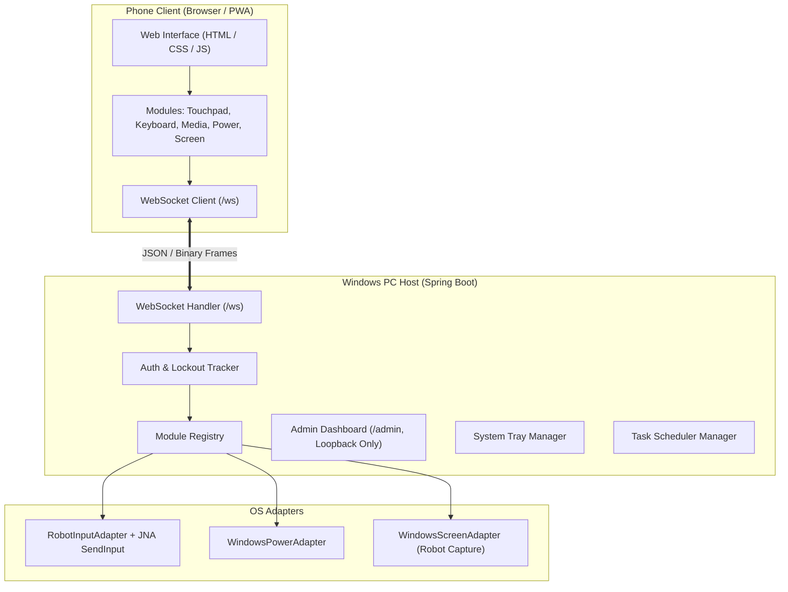

# Phone Remote (Phone-to-PC Controller)

A self-hosted, lightweight remote control system allowing an Android smartphone to control a Windows PC over local Wi-Fi. Built with a **Java (Spring Boot)** host and a zero-install **Progressive Web App (PWA)** client.

<!-- Placeholders for Screenshots and Demo GIF -->
<!--  -->
<!--  -->
<!--  -->

---

## Features

- **Touchpad:** Smooth cursor control, tap-to-click, two-finger right click, two-finger scroll, and tap-and-drag.
- **Keyboard:** Live typing support (including soft keyboards and IMEs), virtual key bar with modifier keys (Ctrl, Alt, Shift, Win), function keys, and navigation keys.
- **Media Controls:** Play/Pause, Next Track, Previous Track, Volume Up/Down, and Mute using Windows multimedia keys.
- **Power Actions:** Shutdown, Restart, Sleep, Hibernate, and Lock Workstation with hold-to-confirm safeguards and cancellation timer.
- **Live Screen Streaming:** Real-time JPEG screen capture with adjustable quality, scaling, and tap-to-control coordinate mapping.
- **Admin Dashboard:** Loopback-only desktop panel (`http://localhost:8080/admin`) for device management, live session tracking, real-time FPS/latency metrics, security PIN updates, and log inspection.
- **System Tray Icon:** Quick status view, browser shortcut to Admin Dashboard, one-click "Disable remote control now" kill-switch, auto-start toggle, and clean shutdown.
- **Auto-Start:** Seamless Windows Task Scheduler integration (`schtasks`) to start the server at user logon in the background.

---

## Architecture



---

## Setup and Installation

### Prerequisites
- Windows 10 or 11
- Java 17 or higher (Java 21 recommended)
- Maven 3.8+ (or bundled Maven wrapper `mvnw.cmd`)

### 1. Build
Clone the repository and build the project:
```powershell
mvn clean package
```

### 2. First Run (Terminal Wizard)
Run the application from a terminal once to set up your security PIN:
```powershell
java -jar server/target/server-1.0-SNAPSHOT.jar
```
The interactive wizard will prompt:
```text
=== Phone Remote First Run ===
Set a 6-digit PIN? (recommended) [y/n]: y
Enter 6-digit PIN: 123456
PIN set securely. You will need it to pair your first device.
==============================
```
*(If skipped, the system operates in manual approval mode where each connecting phone must be approved on the PC Admin page).*

On startup, the console outputs:
```text
Phone address: http://<LAN-IP>:8080
Admin address: http://localhost:8080/admin
```

### 3. Pairing Your Phone
1. Open the **Phone address** on your phone's browser while connected to the same Wi-Fi network.
2. Enter your 6-digit PIN.
3. Once authenticated, a revocable 32-byte cryptographic token is saved in `localStorage`, and the remote control tiles appear immediately.

### 4. Background Start & Auto-Start
- Right-click the **Phone Remote** icon in the Windows System Tray and select **"Enable auto-start"** to configure a scheduled logon task.
- When launched in the background (no interactive terminal), the server checks for an existing `config.json`. If unconfigured, it exits immediately with:
  `Run once from a terminal to set a PIN`

---

## Windows Firewall

When running Phone Remote for the first time, Windows Defender Firewall will prompt to allow network access:
1. **Allow Java on Private networks only.** Ensure the **Private networks** box is checked and **Public networks** is unchecked.
2. **How to verify or adjust manually:**
   - Open **Windows Security** $\rightarrow$ **Firewall & network protection**.
   - Click **Allow an app through firewall**.
   - Click **Change settings**, locate **Java(TM) Platform SE binary**.
   - Verify that only the **Private** checkbox is selected for Phone Remote's port (`8080`).

---

## Pairing and Revocation

```
Phone                         Server                       PC / Admin
  |-- hello ------------------->|
  |                             | Token valid? Yes -> ready
  |<-- need_pin ----------------| (Token missing / PIN required)
  |-- pin ---------------------->| Verify BCrypt hash & rate limits
  |<-- paired (token) ----------| Store SHA-256 token hash
  |                             |
  |  (If No PIN configured)     |-- Pending Approval ---------->|
  |<-- pending_approval --------|<----------- Approve / Deny ---|
  |<-- paired (token) ----------|
```

### Instant Live Revocation
- When a device is revoked or deleted from the desktop Admin Dashboard (`/admin`), the server:
  1. Finds the device's active WebSocket sessions via a thread-safe index.
  2. Dispatches an immediate `{"m":"core","t":"error","d":{"code":"revoked"}}` packet.
  3. Calls `onClose()` on all active modules: **releasing every held key and mouse button and stopping capture threads**.
  4. Marks the session unauthenticated and closes the socket.
  5. The mobile client clears stored credentials, halts outgoing messages, and displays a "Device Revoked" banner.
- **Heartbeat Safety Net:** During periodic WebSocket `ping`/`pong` cycles (every 10 seconds), the server re-validates that the device record exists in configuration.

---

## Security Notes

- **Credential Safety:** PINs are hashed using salted BCrypt. Plaintext PINs and tokens are never logged or stored.
- **Brute Force Protection:** Escalating rate limiting locks out attackers after 5 invalid attempts (5 minutes initial, doubling up to 24 hours).
- **Admin Surface Isolation:**
  - The `/admin` endpoints bind strictly to loopback (`127.0.0.1` / `[::1]`). Non-loopback requests are rejected with `403 Forbidden`.
  - Enforces `Host` header validation against DNS rebinding.
  - Requires CSRF tokens on state-modifying requests and validates WebSocket `Origin` headers.
- **Safe Execution:** Power actions and commands are restricted to strict enum whitelists. No client-supplied input is ever passed to an operating system shell.
- **Logging Auditing:** App and frame logs automatically rotate (10 MB per file, max 3 retained). No typed keystrokes, passwords, tokens, raw payloads, or screen buffers are logged.

---

## Screen Streaming Performance

- **Staged Pipeline:** Decoupled threads joined by bounded `ArrayBlockingQueue`s (capacity 2):
  `Capture Thread` $\rightarrow$ `Scale Thread` $\rightarrow$ `Encode Thread (JPEG)` $\rightarrow$ `Send Thread`.
- **Backpressure Management:** At most 2 unacknowledged frames remain in flight. If the client is slow or network lags, captures are skipped rather than queued, keeping latency flat.
- **Measured Latency & Throughput (Windows Laptop):**
  - **Before Pipelining:** ~5 fps (sequential capture and encode blocking the loop).
  - **After Pipelining:** ~10 fps at ~720p (Capture: ~70–110 ms, Scale: ~5–12 ms, Encode: ~40–98 ms, Frame size: 50–105 KB).
  - **Bottleneck:** `java.awt.Robot.createScreenCapture` is the primary throughput bottleneck.

---

## Known Limits

- **UAC Prompts & Elevated Windows:** Windows User Account Control (UAC) secure desktop and elevated administrator windows isolate input. Synthetic input injection via standard user privileges is blocked by Windows UIPI (User Interface Privilege Isolation). Run the server elevated if UAC interaction is required.
- **Windows Lock Screen:** Input injection is disabled on the Windows lock screen for security reasons.
- **Plain HTTP on LAN:** When accessed over plain `http://<LAN-IP>:8080`, browsers restrict certain PWA capabilities (such as full offline Service Workers). The web app functions normally through standard browser navigation and Home Screen shortcuts.

---

## Design Decisions

1. **WebSocket over REST:** Bidirectional, single-connection transport drastically minimizes protocol overhead and input latency for continuous mouse movements and binary JPEG frames.
2. **Adapter Abstractions:** Operating system specifics are isolated behind `InputAdapter`, `PowerAdapter`, and `ScreenAdapter` interfaces, allowing comprehensive unit and integration testing using mocks and fake adapters without requiring native Windows dependencies in CI.
3. **Fixed Argument Arrays for System Commands:** All external system commands (such as `schtasks`) use fixed argument arrays routed through an injectable `CommandRunner` interface to eliminate shell injection vulnerabilities and facilitate robust unit testing.
4. **Resilient Module Lifecycle:** Modules follow an idempotent lifecycle (`onOpen`, `onMessage`, `onClose`). Unexpected socket disconnects or revocations trigger `onClose()` to guarantee that held keys or mouse buttons are released.
